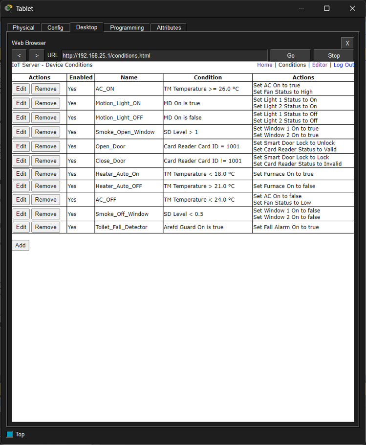

# 🏠 Smart Home IoT Automation & Security System / 智能家居物联网自动化与安防系统

**An offline-capable Smart Home IoT automation and security system simulated in Cisco Packet Tracer**  
**基于 Cisco Packet Tracer 构建的集中式边缘智能家居物联网自动化与安防系统**

 

-blue?style=flat-square)
-orange?style=flat-square)

 

[English Version](#english-version) • [中文版本](#中文版本)

---

# English Version

## 📖 Project Overview
This project designs, configures, and validates an offline-capable **Smart Home IoT Automation & Security System** in **Cisco Packet Tracer**. Built on a centralized edge computing architecture, the system integrates **climate synergy, automated lighting, RFID access control, fire/smoke exhaust, and privacy-preserving elderly fall detection** over a secured wireless local area network.

### 🎯 Key Performance Indicators (KPIs)
* **Energy Efficiency:** Targets a **20–30% daily energy waste reduction** by maintaining indoor temperature within `18.0°C – 26.0°C` via closed-loop AC, Ceiling Fan, and Furnace automation, alongside motion-activated lighting.
* **Sub-2-Second Emergency Response:** Achieves `≤ 2 seconds` automated response latency for critical hazards (e.g., automatic dual-window exhaust upon smoke detection).
* **Strict Access Control:** Enforces **100% authorized entry** by unlocking the Smart Door exclusively for valid RFID credentials (`Card ID = 1001`).
* **Privacy-Preserving Safety:** Detects bathroom fall incidents using a non-optical sudden-motion sensor (`Arefd Guard`) paired with an emergency siren (`Fall Alarm`), avoiding intrusive cameras in private zones.

---

## 🗺️ Network Topology & Spatial Layout

The simulated residence covers **6 functional zones**: **Server Room**, **Master Bedroom**, **Kitchen**, **Work Room**, **Toilet**, and **Living Room**, plus an exterior environmental trigger (`Old Car`) for heat and smoke testing.

---

## 🌐 Network Architecture & IP Addressing

### 1. IP Addressing Scheme (`192.168.25.0/24`)
The network adopts a Class C subnet with static addressing for core infrastructure and automated **DHCP** for Plug-and-Play (PnP) IoT endpoint onboarding.

| Device Category | Interface | SSID / Media | Security / PSK | IP Address / DHCP Range | Subnet Mask | Default Gateway |
| :--- | :--- | :--- | :--- | :--- | :--- | :--- |
| **Home Gateway (`DLC100`)** | Wireless / LAN | Internal (`HomeGateway`) | `WPA2-PSK` / `12345678` (AES) | `192.168.25.1` (Static) | `255.255.255.0` | Self |
| **Internal Server (`Server-PT`)** | `FastEthernet0` | Wired (Ethernet) | N/A | `192.168.25.2` (Static) | `255.255.255.0` | `192.168.25.1` |
| **IoT Devices & Clients** | `Wireless0` (`PT-IOT-NM-1W`) | `HomeGateway` | `WPA2-PSK` / `12345678` (AES) | `192.168.25.3 – 192.168.25.254` (DHCP) | `255.255.255.0` | `192.168.25.1` |

### 2. End-to-End Data Communication Flow
1. **Data Generation (Input):** Environmental sensors (`TM`, `SD`, `Card Reader`) detect state changes and encapsulate telemetry into PDUs.
2. **Wireless Transmission:** Telemetry is transmitted over `2.4 GHz` Wi-Fi (`WPA2-PSK AES`) via each device's `PT-IOT-NM-1W` wireless adapter.
3. **Edge Processing:** The **Home Gateway** (`192.168.25.1`) evaluates incoming payloads locally against registered `IF-THEN` automation conditions.
4. **Command Execution (Output):** Once triggered, the gateway dispatches wireless control commands directly to target actuators (`AC`, `Fan`, `Furnace`, `Window 1 & 2`, `Smart Door`, `Fall Alarm`).
5. **Client Monitoring (`HTTP/TCP`):** Residents and administrators monitor real-time status via the **IoT Monitor** web dashboard on the **Laptop** (Work Room) or **Tablet PC** (Living Room).

---

## 📦 Hardware Inventory (15 Connected IoT Endpoints)

| Subsystem | Device Label | Hardware Type | Zone | Role |
| :--- | :--- | :--- | :--- | :--- |
| **Core & Clients** | `Home Gateway` / `Server` | `DLC100` / `Server-PT` | Server Room | Central wireless AP, IoT controller, and backend server |
| | `Laptop` / `Tablet` | `Laptop-PT` / `TabletPC-PT` | Work Room / Living Room | Configuration terminal & portable daily monitoring UI |
| **Climate Synergy** | `TM` | Temperature Monitor | Living Room | Real-time ambient temperature sensing |
| | `AC` / `Fan` / `Furnace` | Air Conditioner / Ceiling Fan / Furnace | Living Room | Synergistic cooling (AC + Fan circulation) & automated heating |
| **Access Control** | `Card Reader` | RFID Reader | Front Entrance | Authenticates `Smart Card` (`ID: 1001`) vs. `Unknown Card` |
| | `Smart Door` | Smart Door | Front Entrance | Contactless automated locking/unlocking |
| **Fire & Exhaust** | `SD` | Smoke Detector | Living Room | Monitors atmospheric smoke/CO concentration |
| | `Window 1` & `Window 2` | Smart Windows | Living Room / Kitchen | Automated cross-ventilation for rapid smoke exhaustion |
| **Lighting** | `MD` | Motion Detector | Living Room | Occupancy detection for energy-saving lighting |
| | `Light 1` & `Light 2` | Smart Lights | Living Room / Bedroom | Automated occupancy-based illumination |
| **Elderly Safety** | `Arefd Guard` | Motion Detector | Toilet | Non-optical sudden-motion fall detection |
| | `Fall Alarm` | Siren | Toilet | Immediate audible/visual emergency alert |
| **Test Trigger** | `Car` | Old Car | Exterior | Simulated heat and smoke emission source |

---

## ⚙️ Automation Logic (11 Closed-Loop IoT Rules)

| Rule Name | Trigger Condition | Automated Action(s) |
| :--- | :--- | :--- |
| `AC_ON` | `TM Temperature >= 26.0 °C` | Set `AC` On to `true` & Set `Fan` Status to `High` |
| `AC_OFF` | `TM Temperature < 24.0 °C` | Set `AC` On to `false` & Set `Fan` Status to `Low` |
| `Heater_Auto_On` | `TM Temperature < 18.0 °C` | Set `Furnace` On to `true` |
| `Heater_Auto_OFF` | `TM Temperature > 21.0 °C` | Set `Furnace` On to `false` |
| `Motion_Light_ON` | `MD On is true` | Set `Light 1` Status to `On` & Set `Light 2` Status to `On` |
| `Motion_Light_OFF` | `MD On is false` | Set `Light 1` Status to `Off` & Set `Light 2` Status to `Off` |
| `Smoke_Open_Window` | `SD Level > 1` | Set `Window 1` On to `true` & Set `Window 2` On to `true` |
| `Smoke_Off_Window` | `SD Level < 0.5` | Set `Window 1` On to `false` & Set `Window 2` On to `false` |
| `Open_Door` | `Card Reader Card ID = 1001` | Set `Smart Door` Lock to `Unlock` & `Card Reader` Status to `Valid` |
| `Close_Door` | `Card Reader Card ID != 1001` | Set `Smart Door` Lock to `Lock` & `Card Reader` Status to `Invalid` |
| `Toilet_Fall_Detector` | `Arefd Guard On is true` | Set `Fall Alarm` On to `true` |

---

## 🧪 Verification & Test Results

| Test Scenario | Input / Simulated Value | Verified Actual Outcome | Status |
| :--- | :--- | :--- | :---: |
| **Overheating Cooling (`AC_ON`)** | `TM = 33.60 °C` (`≥ 26.0 °C`) | `AC` turned ON; `Fan` switched to `High` | ✅ Pass |
| **Optimal Cooling (`AC_OFF`)** | `TM = 20.27 °C` (`< 24.0 °C`) | `AC` turned OFF; `Fan` stepped down to `Low` | ✅ Pass |
| **Cold Heating (`Heater_Auto_On`)** | `TM = 10.18 °C` (`< 18.0 °C`) | `Furnace` turned ON | ✅ Pass |
| **Warm Heating (`Heater_Auto_OFF`)** | `TM = 23.00 °C` (`> 21.0 °C`) | `Furnace` turned OFF | ✅ Pass |
| **Smoke Hazard (`Smoke_Open_Window`)** | `SD Level > 1` | `SD` LED turned Red; `Window 1` & `Window 2` opened | ✅ Pass |
| **Air Cleared (`Smoke_Off_Window`)** | `SD Level = 0.000025` (`< 0.5`) | `Window 1` & `Window 2` automatically closed | ✅ Pass |
| **Authorized RFID (`Open_Door`)** | Drag `Smart Card` (`ID: 1001`) | Reader Status `Valid` (Green LED); `Smart Door` unlocked | ✅ Pass |
| **Unauthorized RFID (`Close_Door`)** | Drag `Unknown Card` | Reader
